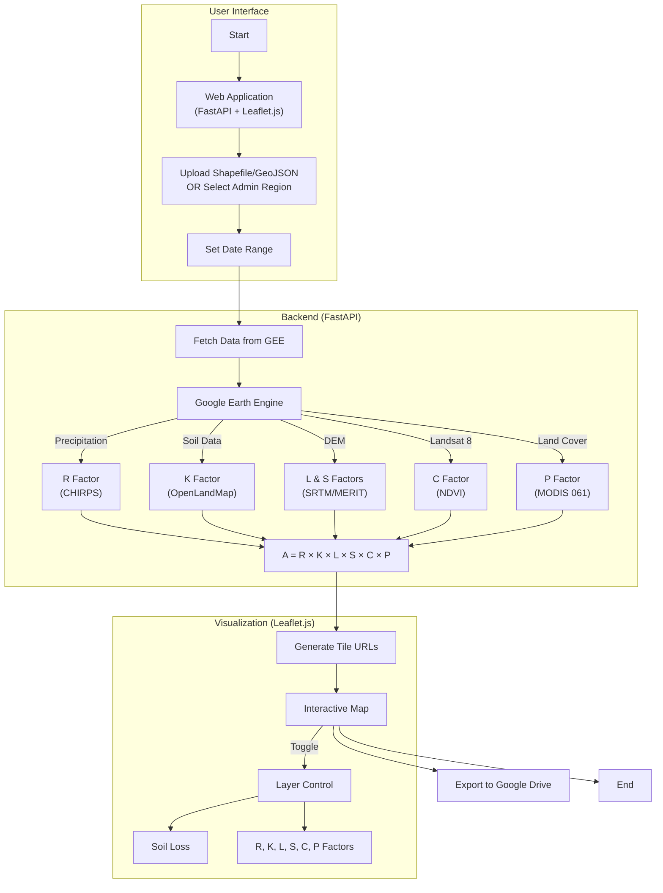

# RUSLE - Revised Universal Soil Loss Equation

[](https://nriveras.github.io/RUSLE/)

Implementation of the RUSLE model using Google Earth Engine and Python, available both as a Jupyter notebook and a web application.

📖 **[View Full Documentation](https://nriveras.github.io/RUSLE/)**

## Example Output


*Soil loss estimation for Germany (2021-01-20 to 2022-01-20)*

---

## Quick Start

### Prerequisites

- [uv](https://docs.astral.sh/uv/) - Fast Python package installer
- Python 3.10+ (managed automatically by uv)
- [Google Earth Engine account](https://courses.spatialthoughts.com/gee-sign-up.html)

### Installation

```bash
# Clone the repository
git clone https://github.com/nriveras/RUSLE.git
cd RUSLE

# Install dependencies with uv (creates .venv automatically)
uv sync

# Activate the virtual environment
source .venv/bin/activate  # Linux/macOS
# or
.venv\Scripts\activate     # Windows
```

### Option 1: Run the Web Application

```bash
# Start the web server
python run.py

# Or with auto-reload for development
python run.py --reload
```

Open your browser at **http://localhost:8000/app**

The web application allows you to:
- Upload shapefiles (ZIP) or GeoJSON files as area of interest
- Select an administrative region by name (uses FAO GAUL boundaries)
- Specify date range for analysis
- Visualize soil loss and all RUSLE factors on an interactive map
- Toggle individual layers (R, K, L, S, C, P factors)
- Export results to Google Drive

### Option 2: Run the Jupyter Notebook

1. Open VS Code and select the `.venv` Python interpreter
2. Open `00_scripts/RUSLE.ipynb`
3. Run the cells sequentially

### Google Earth Engine Setup

1. Create a GEE project at [Google Cloud Console](https://console.cloud.google.com/)
2. Enable the Earth Engine API
3. Register for Earth Engine at [https://earthengine.google.com/signup/](https://earthengine.google.com/signup/)
4. Update `GEE_PROJECT` in the notebook or create a `.env` file:
   ```bash
   cp .env.example .env
   # Edit .env with your project ID
   ```

### Option 3: Run with Docker

```bash
# Build the Docker image
docker build -t rusle-app .

# Run with docker-compose (recommended)
docker-compose up -d

# Or run directly with Docker
docker run -d \
  -p 8000:8000 \
  -v ~/.config/earthengine:/home/appuser/.config/earthengine:ro \
  -e RUSLE_GEE_PROJECT=your-project-id \
  rusle-app
```

**Note:** You must authenticate with GEE locally first (`earthengine authenticate`) before running the container, as it mounts your credentials.

---

## Project Structure

```
RUSLE/
├── app/                          # Web application (FastAPI)
│   ├── __init__.py
│   ├── main.py                   # FastAPI entry point
│   ├── config.py                 # Configuration (pydantic-settings)
│   ├── routers/
│   │   ├── upload.py             # POST /api/upload
│   │   ├── process.py            # POST /api/process
│   │   └── visualize.py          # GET /api/visualize/{job_id}
│   ├── services/
│   │   ├── gee_service.py        # Google Earth Engine integration
│   │   ├── rusle_calculator.py   # RUSLE factor calculations
│   │   └── shapefile_handler.py  # Shapefile/GeoJSON processing
│   ├── static/
│   │   ├── css/style.css         # Application styles
│   │   └── js/app.js             # Leaflet map & API interactions
│   └── templates/
│       └── index.html            # Main application page
│
├── 00_scripts/
│   ├── RUSLE.ipynb               # Jupyter notebook implementation
│   ├── rusle_utils.py            # RUSLE calculation utilities
│   └── gee_auth.py               # GEE authentication helper
│
├── 01_references/                # Reference materials
├── 02_input/                     # Input shapefiles
├── 03_output/                    # Generated outputs
├── data/
│   ├── uploads/                  # Web app file uploads
│   └── output/                   # Web app outputs
│
├── run.py                        # Web app entry point
├── pyproject.toml                # Dependencies (uv)
├── .env.example                  # Environment template
└── README.md
```

---

## Web Application

### API Endpoints

| Endpoint | Method | Description |
|----------|--------|-------------|
| `/app` | GET | Main application page |
| `/api/upload` | POST | Upload shapefile (ZIP) or GeoJSON |
| `/api/upload/{session_id}/preview` | GET | Preview uploaded AOI as GeoJSON |
| `/api/process` | POST | Run RUSLE calculation |
| `/api/process/{job_id}/statistics` | GET | Get result statistics |
| `/api/process/{job_id}/export` | POST | Export to Google Drive |
| `/api/visualize/{job_id}` | GET | Get map layer configuration |
| `/api/visualize/{job_id}/folium` | GET | Get embeddable Folium HTML map |
| `/api/legend` | GET | Get soil loss legend classes |
| `/health` | GET | Health check endpoint |

### Process Request Example

```bash
curl -X POST http://localhost:8000/api/process \
  -H "Content-Type: application/json" \
  -d '{
    "admin_region": "Metropolitana",
    "date_from": "2022-01-01",
    "date_to": "2023-01-01",
    "dem_source": "SRTM",
    "export_scale": 90
  }'
```

### Architecture



---

## Data Sources

| Factor | Data Source | Resolution | Dataset ID |
|--------|-------------|------------|------------|
| **R** (Rainfall Erosivity) | CHIRPS Daily | 5.5 km | `UCSB-CHG/CHIRPS/DAILY` |
| **K** (Soil Erodibility) | OpenLandMap | 250 m | `OpenLandMap/SOL/*` |
| **L, S** (Topography) | SRTM / MERIT | 30 m / 90 m | `USGS/SRTMGL1_003` |
| **C** (Vegetation Cover) | Landsat 8 SR | 30 m | `LANDSAT/LC08/C02/T1_L2` |
| **P** (Erosion Control) | MODIS Land Cover | 500 m | `MODIS/061/MCD12Q1` |

---

## RUSLE Equation

The **Revised Universal Soil Loss Equation (RUSLE)** estimates average annual soil erosion:

$$A = R \times K \times L \times S \times C \times P$$

Where:

| Factor | Name | Description | Unit |
|--------|------|-------------|------|
| **A** | Soil Loss | Average annual soil loss | t/ha/year |
| **R** | Rainfall Erosivity | Effect of rainfall intensity | MJ·mm/(ha·h·yr) |
| **K** | Soil Erodibility | Susceptibility of soil to erosion | t·ha·h/(ha·MJ·mm) |
| **L** | Slope Length | Effect of slope length | dimensionless |
| **S** | Slope Steepness | Effect of slope gradient | dimensionless |
| **C** | Cover Management | Effect of vegetation cover | dimensionless |
| **P** | Support Practices | Effect of conservation practices | dimensionless |

> **t** = metric tonne (1 t = 1 Mg = 1,000 kg) throughout this project. K is reported directly in SI units.

### Factor Calculations

- **K Factor** (Sharpley & Williams, 1990; as used in Williams, 1995): K = f_csand × f_cl-si × f_orgc × f_hisand, based on sand, silt, clay, and organic carbon content. The result is in US customary units and is multiplied by 0.1317 (Foster et al., 1981) to convert it to SI (t·ha·h/(ha·MJ·mm))
- **R Factor**: R = 0.0483 × P^1.610 where P is annual precipitation
- **L Factor**: L = (λ / 22.13)^m where m varies with slope
- **S Factor**: S = (0.43 + 0.3S + 0.043S²) / 6.613
- **C Factor** (De Jong, 1994): C = 0.431 - 0.805 × NDVI
- **P Factor**: Based on MODIS land cover classification (Chuenchum et al., 2019)

---

## Soil Loss Classification

| Range (t/ha/yr) | Class | Color |
|-------------------|-------|-------|
| 0 - 5 | Very Low | � Dark Purple (#440154) |
| 5 - 10 | Low | 🟣 Purple (#482878) |
| 10 - 20 | Moderate | 🔵 Blue (#31688e) |
| 20 - 30 | High | 🟢 Teal (#1f9e89) |
| 30 - 40 | Very High | 🟢 Green (#35b779) |
| 40 - 50 | Severe | 🟡 Lime (#b5de2b) |
| > 50 | Very Severe | 🟡 Yellow (#fde725) |

---

## References

1. Renard, K.G., Foster, G.R., Weesies, G.A., McCool, D.K., & Yoder, D.C. (1997). *Predicting Soil Erosion by Water: A Guide to Conservation Planning with the Revised Universal Soil Loss Equation (RUSLE)*. USDA Agricultural Handbook No. 703.

2. Williams, J.R. (1995). The EPIC Model. In V.P. Singh (Ed.), *Computer Models of Watershed Hydrology*. Water Resources Publications.

3. Sharpley, A.N., & Williams, J.R. (Eds.). (1990). *EPIC - Erosion/Productivity Impact Calculator: 1. Model Documentation*. USDA Technical Bulletin No. 1768.

4. Foster, G.R., Young, R.A., & Neibling, W.H. (1981). Sediment composition for nonpoint source pollution analyses. *Transactions of the ASAE*, 24(5), 1444-1448.

5. De Jong, S.M. (1994). Derivation of vegetative variables from a Landsat TM image for modelling soil erosion. *Earth Surface Processes and Landforms*, 19(2), 165-178.

6. Chuenchum, P., Xu, M., & Tang, W. (2019). Estimation of soil erosion and sediment yield in the Lancang–Mekong river using the modified revised universal soil loss equation and GIS techniques. *Water*, 12(1), 135.

7. Uddin, K., Abdul Matin, M., & Maharjan, S. (2018). Assessment of land cover change and its impact on changes in soil erosion risk in Nepal. *Sustainability*, 10(12), 4715.

---

## License

MIT License
